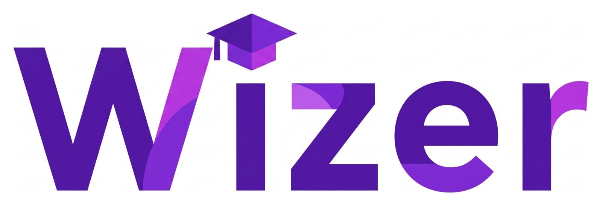

<p align="center">
  
</p>

<p align="center">
  <strong>Tu clase semipresencial, en un solo lugar.</strong><br>
  Chat en tiempo real, equipos, pizarra colaborativa, tareas y archivos, conectando a todos los campus en una misma clase.
</p>

<p align="center">
  
  
  
  
</p>

---

## El problema

En la educación semipresencial, docentes y alumnos reparten su trabajo entre una plataforma oficial para las notas, WhatsApp para hablar y Drive para los archivos. Los mensajes importantes se pierden, los equipos se desorganizan y los docentes dedican más tiempo a juntar entregas que a enseñar.

**Wizer** reúne todo en un solo espacio: la clase, sus equipos, sus conversaciones, sus tareas y sus archivos, con varias sedes conectadas a la misma clase.

## Funcionalidades

| | |
|---|---|
| 🏫 **Clases** | Creación por el docente y unión de los alumnos con un código de 6 caracteres |
| 👥 **Equipos** | Armado manual o automático, con chat y pizarra propios |
| 💬 **Chat en tiempo real** | General y por equipo, con presencia, "escribiendo…", edición, reacciones, menciones y reenvío automático si se corta la conexión |
| 🎨 **Pizarra colaborativa** | Basada en Excalidraw, con cursores en vivo y exportación a PNG |
| 📝 **Tareas y entregas** | Plazos, entregas tardías configurables, entregas por equipo y calificación por puntaje o aprobado/desaprobado |
| 📁 **Archivos** | Subida directa a almacenamiento, escaneo antivirus y vista previa de PDF e imágenes |
| 🔔 **Notificaciones** | En vivo dentro de la plataforma |
| 🔐 **Acceso** | Correo verificado o Google; las cuentas docentes se crean por invitación |

## Stack

| Capa | Tecnologías |
|------|-------------|
| **Backend** | C# · .NET 10 · ASP.NET Core · EF Core · SignalR · FluentValidation · Serilog |
| **Frontend** | React 19 · Vite · TypeScript · TanStack Router y Query · Zustand · Tailwind CSS v4 · shadcn/ui · Orval · Excalidraw |
| **Datos** | PostgreSQL · Garage (S3) · ClamAV |
| **Pruebas** | xUnit · Moq · Testcontainers · Vitest · React Testing Library · MSW · Playwright |
| **Infraestructura** | Docker Compose · GitHub Actions · Caddy · Grafana Alloy + Loki |

## Arquitectura

```text
              Navegador
                  │
        Reverse proxy (un solo origen)
     /        /api       /hubs      /storage
     │          │          │            │
  React SPA   ASP.NET Core API       Garage
              + SignalR (WebSockets)
                  │
       PostgreSQL · ClamAV · Correo
```

- **Backend:** monolito modular (`Identity`, `Classes`, `Teams`, `Chat`, `Whiteboard`, `Assignments`, `Submissions`, `Files`, `Notifications`…), sin MediatR, con comunicación entre módulos mediante interfaces públicas.
- **Frontend:** arquitectura por features con el patrón container/presentational. El cliente de la API se genera desde OpenAPI con Orval.
- **Tiempo real:** las mutaciones van por REST y SignalR emite los eventos. El chat usa idempotencia por mensaje y la pizarra reconcilia los cambios por versión de cada elemento.
- **Seguridad:** JWT en cookies HttpOnly, autorización por rol y por pertenencia a la clase, y URLs firmadas para los archivos.

El detalle completo está en [`.ia/architecture.md`](.ia/architecture.md).

## Estructura del repositorio

```text
wizer/
├── .ia/               arquitectura, reglas y sistema de diseño
├── docs/              requisitos y riesgos
├── assets/            logo
├── apps/
│   ├── backend/       API .NET + pruebas
│   └── frontend/      SPA React
├── Makefile           comandos de desarrollo
└── docker-compose.dev.yml
```

## Documentación

| Documento | Contenido |
|-----------|-----------|
| [`docs/01-requisitos.md`](docs/01-requisitos.md) | Requisitos funcionales y no funcionales |
| [`docs/03-riesgos.md`](docs/03-riesgos.md) | Riesgos del proyecto |
| [`.ia/README.md`](.ia/README.md) | Stack y reglas no negociables |
| [`.ia/business-rules.md`](.ia/business-rules.md) | Reglas de negocio |
| [`.ia/permissions.md`](.ia/permissions.md) | Roles y permisos |
| [`.ia/realtime.md`](.ia/realtime.md) | Chat, presencia y pizarra en tiempo real |
| [`.ia/design/README.md`](.ia/design/README.md) | Sistema de diseño |

## Cómo levantarlo

**Requisitos:** .NET 10 SDK, Node 24, Docker con Compose y `make`.

```bash
make setup        # primera vez: dependencias de back y front
make infra-up     # PostgreSQL, Garage y Mailpit en Docker
make api          # terminal 1 → API en http://localhost:5080
make web          # terminal 2 → app en http://localhost:5173
```

| Comando | Qué hace |
|---------|----------|
| `make help` | Lista todos los comandos |
| `make test` | Pruebas de backend (unitarias e integración) y frontend |
| `make check` | Lint, formato, tipos y pruebas: lo mismo que la CI |
| `make api-client` | Regenera el cliente TypeScript después de cambiar la API |
| `make infra-down` | Apaga la infraestructura |

Mailpit (correos de desarrollo) queda en http://localhost:8025.

## Equipo

Proyecto desarrollado por **Omar** (líder técnico), **Luis** y **Rolando**, todos fullstack.

## Contribuir

- Ramas `feat/*` y `fix/*` con PR hacia `develop`, y releases de `develop` a `main`.
- Commits con [Conventional Commits](https://www.conventionalcommits.org/).
- Antes de escribir código, leer [`.ia/workflow.md`](.ia/workflow.md).
